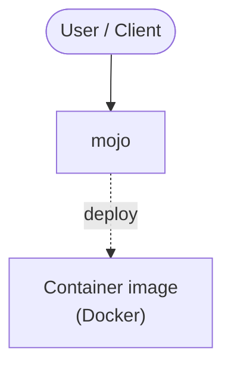

# Context Map — `mojo`

> Auto-generated architecture & deployment context map. Summarizes the core application, container/cloud footprint, and database connections. Regenerate after significant structural changes.

**Repo:** `avnit/mojo` · **Fork** · Public · Primary language: Perl · Default branch: `master` · Files: 407

**Description:** Mojolicious - Perl real-time web framework

## 1. Core application

  :** 3000, 8080

## 2. Containers & cloud applications

**Containers:**
- `lib/Mojolicious/Command/Author/generate/dockerfile.pm`

## 3. Database connections

_No database drivers or connection strings detected._

## 4. Architecture diagram

## 5. Security posture

- **Static scan findings:** 7 critical, 1 medium

| Severity | Rule | File:Line |
|---|---|---|
| critical | private-key-block | `lib/Mojo/IOLoop/resources/server.key:1` |
| critical | private-key-block | `t/mojo/certs/bad.key:1` |
| critical | private-key-block | `t/mojo/certs/ca.key:1` |
| critical | private-key-block | `t/mojo/certs/client.key:1` |
| critical | private-key-block | `t/mojo/certs/domain.key:1` |
| critical | private-key-block | `t/mojo/certs/mojo_server.key:1` |
| critical | private-key-block | `t/mojo/certs/server.key:1` |
| medium | js-innerhtml | `lib/Mojolicious/resources/public/mojo/bootstrap/bootstrap.js:6` |

---
_Generated by repo context-mapping pass on 2026-08-13._